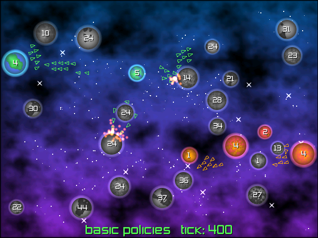

# Galcon 2006, ported to Nim

A local Nim port of **Phil Hassey's original 2006 Galcon**, the Ludum Dare 8
Python entry that became Galcon Classic. All credit for the original game,
its design, code, and original assets belongs to **Phil Hassey**.

The port uses Polyworld for deterministic randomness, BASIC policy hosts,
policy packages, and replay files. Silky draws everything in 2D using the
original nebula background, sphere shader, atmospheric glow, fonts, particle
sprite, sounds, and music. Planet terrain follows Phil's original plasma
algorithm and owner palettes.

> AI disclaimer: This Nim port was generated with Codex.

The original release is [473_philhassey.zip](https://www.galcon.com/history/files/473_philhassey.zip).
The root [LICENSE](LICENSE) is copied unchanged from that release's GNU GPL
version 2 license. The bundled fonts retain their original notices in
[assets/read_me.html](assets/read_me.html).

## Run locally

Dependencies are installed with Nimby. From the workspace parent:

```sh
nimby install coworld-galcon/galcon.nimble
cd coworld-galcon
nim c -d:release --out:build/galcon src/galcon.nim
./build/galcon
```

In the current `/Users/me/p` workspace, the sibling dependencies are already
available. The built executable is `build/galcon`.

The original menu includes tutorial, play, help, and quit. Left and right
change difficulty. To start immediately:

```sh
./build/galcon --start --difficulty easy --seed 8
```

Click your planets to build a selection. Double-click one of your planets
to select all of them. Drag from any planet to a destination to send ships
from the selected planets. Drag empty space to select a box, hold Shift to
add to the selection, and right-click to clear it.

Number keys 1 through 9 send 10 through 90 percent. Zero sends 100 percent.
Tab cycles ship counts, production, morale, and hidden labels. Space or F10
pauses, F2 toggles music, Alt-Enter toggles fullscreen, and Escape returns to
the menu. Ship-count labels have transparent backgrounds.

## BASIC policies and replays

The computer is a real Bassy BASIC policy. `players/classic.bas` ports Phil's
original neighbor-shuffling, attack, and reinforcement strategy.
`players/expand.bas` is an alternative policy favoring productive weak planets.

Watch two policies play, or replace the human's opponent:

```sh
./build/galcon --bot players/classic.bas --bot players/expand.bas --seed 77
./build/galcon --player --bot players/expand.bas --start
```

A policy restarts every tick with persistent variables and bounded memory,
work, and output. Planet IDs are zero-based, owners are 0 for neutral, 1 for
green, and 2 for red/orange. `selfPlayer()` identifies the policy's player.
Queries include `planetCount()`, `worldTick()`, `owner(id)`, `ships(id)`,
`production(id)`, `morale(id)`, `realMorale(id)`, `realShips(id)`, `x(id)`,
`y(id)`, `ready(id)`, `neighborCount(id)`, and `neighbor(id, rank)`.
`shuffleNeighbors(id)` changes the policy's own neighbor order.
`launch(source, target, count)` and `send(source, target, percent)` return
the number sent and enforce ownership. `fraction(id, numerator, denominator)`
truncates a stock fraction, `reinforcement(source, target)` computes half the
friendly strength difference, and `stronger(source, target)` checks the
original ten-ship reinforcement threshold. Raw BASIC and Polyworld policy
packages are accepted by `--bot`.

Policy uploads are limited to 16 MiB and 256 files. Decoded source, resources,
resource names, and package accounting overhead share a 64 MiB limit enforced
during decompression. These package limits are separate from the BASIC VM's
256 KiB source and 4 MiB runtime-memory limits.

To check the native Coworld package handoff, build with `-d:coworld`, then run:

```sh
python3 tests/test_coworld_packages.py build/galcon-coworld build/package-evidence
```

The evidence directory must be new. The check retains all inputs, private logs,
statuses, results, and replays. It runs ordinary Duel games for valid stored and
deflated ZIPs, and verifies player-attributed rejection of oversized packages,
including archives with false size metadata.

```sh
./build/galcon --headless --bot players/classic.bas:2 --seed 77 \
  --seconds 60 --record build/match.replay
./build/galcon --replay build/match.replay
./build/galcon --headless --replay build/match.replay
```

Build a graphics-free executable for batch runs:

```sh
nim c -d:release -d:headless --out:build/galcon-headless src/galcon.nim
./build/galcon-headless --seed 77 --ticks 1800
```

The optional `-d:coworld` build uses Polyworld's existing two-seat file-player
handoff, policy logs, annotations, result files, and replay artifact protocol.
No hosting or publishing is configured in this project.

## Determinism and fidelity

The simulation runs at the original **32 ticks per second**. Positions,
headings, collisions, and particles use Fixxy Q16.16 values. Ship stocks use
extended 64-bit fixed-point values with 16 fractional bits. Production,
morale, percentage rounding, map separation, and neighbor distances use
integer arithmetic. Tick code never uses native floating-point math or
wall-clock time.

Polyworld's portable seeded RNG drives maps, with separate seeded streams
for policies, terrain, and effects. Drawing consumes no simulation randomness.
Rendering converts fixed values to floats only after simulation decisions.
Replays store authorized launch orders and verify every tick's state hash,
including effects. Changing window size, frame rate, sound, or drawing does
not change simulation results for the same seed, policies, and tick orders.

The original difficulty counts, production and morale rules, one-pixel ship
speed, weighted flock collisions, capture threshold, bounded ship and effect
pools, three-second endings, and tutorial stages are preserved. Fixed-point
rounding and portable RNG replace the original platform-dependent float
physics and Python/C random generators, so map layouts and match outcomes
can differ from the Python release. The group-selection controls and default
ship-count labels carry forward the requested later-Galcon conveniences.

## Check

```sh
nim check src/galcon.nim
nim check tests/tests.nim
nim r tests/tests.nim
nim r -d:release -d:fixedChecks tests/tests.nim
nim r -d:release tests/bench_ticks.nim
```

Tests cover original rules, policy ownership and work limits, input gestures,
opaque planet textures, independent deterministic matches, every-tick replay
verification, and a fixed golden hash. The build workflow covers Linux,
macOS, and Windows. No documentation site or docs workflow is included.
